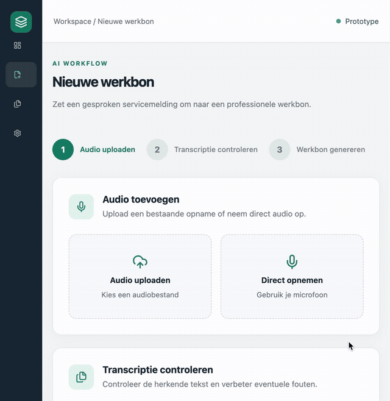

# Field Service AI

**AI-powered service reports from voice recordings.**

Field Service AI is a full-stack application that helps field service technicians turn spoken service notes into structured, editable work orders.

Instead of manually writing reports after each customer visit, technicians can upload an audio file or record a service update directly in the browser. The application transcribes the audio and uses a local language model to extract relevant information into a professional work order.

## 🎥 Demo

See Field Service AI in action — from audio transcription to AI-generated work orders and PDF export.



## Features

- **Audio recording and upload** — Record service notes directly in the browser or upload an existing audio file.
- **Speech-to-text** — Transcribe Dutch audio using Faster-Whisper.
- **AI-powered report generation** — Extract customer details, problems, completed work, materials, working hours and follow-up actions using Ollama.
- **Address extraction** — Recognize street names, house numbers, postal codes and cities from spoken notes.
- **Editable work orders** — Review and adjust generated information before exporting.
- **PDF export** — Download professionally formatted service reports.
- **Local AI processing** — Run transcription and language model inference locally without relying on external AI APIs.

## Tech Stack

| Layer | Technologies |
|---|---|
| Frontend | React, TypeScript, Vite |
| Backend | Python, FastAPI |
| Speech Recognition | Faster-Whisper |
| Language Model | Ollama, Qwen 2.5 |
| PDF Generation | jsPDF |
| Styling | CSS |
| API Communication | REST API |

## How It Works

1. **Record or upload audio** — A technician describes a completed service visit.
2. **Transcribe the recording** — Faster-Whisper converts speech into editable text.
3. **Generate a work order** — Ollama extracts structured information from the transcript.
4. **Review and edit** — The technician verifies customer details, work performed and materials.
5. **Export to PDF** — The completed work order is downloaded as a PDF.

## Example

**Voice input:**

> I visited Mr. De Vries at Kerkstraat 24A, 6828 AB Arnhem. The heating system showed error code E10 and had low water pressure. I refilled the system, restarted the boiler and used one sealing ring. The visit took one and a half hours. A follow-up visit is required next week.

**Generated work order:**

| Field | Extracted information |
|---|---|
| Customer | Mr. De Vries |
| Address | Kerkstraat 24A, 6828 AB Arnhem |
| Problem | Heating system error E10, low water pressure |
| Work performed | System refilled and boiler restarted |
| Materials | 1 sealing ring |
| Hours worked | 1.5 |
| Follow-up required | Yes |

## Project Structure

```text
field-service-ai/
├── backend/
│   └── app/
│       ├── api/
│       ├── schemas/
│       └── services/
├── frontend/
│   ├── public/
│   └── src/
│       ├── components/
│       ├── features/
│       ├── services/
│       ├── types/
│       └── utils/
└── README.md
```

## Running Locally

### Prerequisites

- Python
- Node.js and npm
- Ollama
- The `qwen2.5:1.5b` model

### Start Ollama

Install Ollama and download the model:

```bash
ollama pull qwen2.5:1.5b
```

Make sure Ollama is running.

### Start the backend

Navigate to the backend directory, activate your Python virtual environment and install the project dependencies.

Start the FastAPI application:

```bash
uvicorn app.main:app --reload --port 8001
```

The backend API will be available at:

`http://localhost:8001`

### Start the frontend

```bash
cd frontend
npm install
npm run dev
```

Open:

`http://localhost:5173`

> Note: The backend requires the Python dependencies used by the project, including Faster-Whisper, Ollama and FastAPI. Installation commands may vary depending on the project's dependency configuration.

## Current Status

Field Service AI is a working prototype developed to explore how local AI can simplify administrative work for field service technicians.

Future improvements may include customer management, work order history, authentication and integration with existing field service systems.

## Author

Developed by [Hind Baroudi](https://github.com/hindbaroudii).

## License

No open-source license has been assigned yet.
